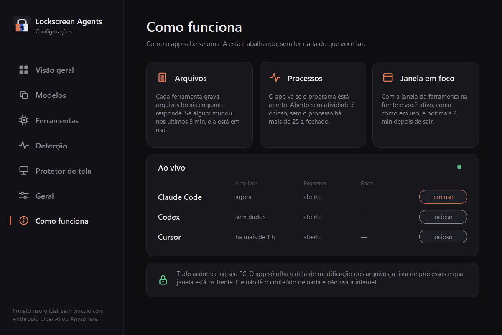

<p align="center"></p>

<h1 align="center">Lockscreen Agents</h1>

**Português** · [English](#english)

Mascotes na tela de bloqueio e no protetor de tela do Windows que mostram, num relance, quais assistentes de código você está usando: **Claude Code**, **Codex** e **Cursor**.


| Estado | Como aparece |
| --- | --- |
| **em uso** | mascote colorido (no protetor de tela ele anda; o Cursor flutua) |
| **ocioso** | ferramenta aberta, sem atividade: mascote cinza e parado |
| **fechado** | ferramenta não está rodando: mascote bem apagado |


> Projeto **não oficial**. Não tem vínculo com a Anthropic, a OpenAI nem a Anysphere (Cursor). Os mascotes são desenhos próprios, inspirados nas ferramentas. Claude, Codex e Cursor são marcas dos respectivos donos.

## O que faz

- **Tela de bloqueio**: gera uma imagem com o estado de cada ferramenta e a define como lock screen sempre que o estado muda. Aperte `Win + L` e veja.
- **Protetor de tela animado**: depois de alguns minutos sem mexer no PC, abre uma tela cheia com os mascotes animados. Qualquer tecla ou movimento do mouse fecha.
- **Janela de configurações** moderna e animada, com prévia ao vivo da tela de bloqueio (veja abaixo).
- **Ícone na bandeja** (perto do relógio): clique duas vezes para abrir as configurações; o menu também pausa, atualiza a lock screen e testa o protetor.
- Inicia junto com o Windows.

## Configurações

Clique duas vezes no ícone da bandeja (ou use **Configurações…** no menu). Tudo é salvo na hora.


- **Modelos**: o visual da tela. Hoje existe o modelo **Mascotes**; os próximos aparecem como “em breve” (e há um botão para sugerir o seu).
- **Ferramentas**: escolha quais mascotes aparecem (Claude Code, Codex, Cursor).
- **Detecção**: tempo até ficar ocioso, tolerância para "fechado" e se a janela em foco conta como em uso.
- **Protetor de tela**: ligar, abrir após N minutos, bloquear o PC ao fechar.
- **Geral**: idioma (automático, português ou inglês), iniciar com o Windows, abrir a pasta de dados e restaurar os padrões.
- **Como funciona**: explica como o app sabe se uma IA está em uso e mostra, ao vivo, os sinais lidos de cada ferramenta.




## Requisitos

- Windows 10 ou 11
- Python 3.10 ou mais novo, com `tkinter` (já vem no instalador oficial de python.org)
- A tela de bloqueio precisa estar em **Configurações → Personalização → Tela de bloqueio → Personalizar sua tela de bloqueio: Imagem**. No modo "Windows Spotlight" o Windows ignora a imagem do app.

## Instalação

### Instalador (Windows 10/11)

Baixe o `LockscreenAgents-Setup-<versão>.exe` na página de **Releases** e execute. Não precisa de Python nem de administrador. Também há uma versão portátil em `.zip` (extraia e abra `LockscreenAgents.exe`).

> O instalador ainda **não é assinado digitalmente**, então o Windows pode mostrar o aviso do SmartScreen ("Windows protegeu seu PC"). Clique em **Mais informações → Executar assim mesmo**. Os arquivos da Release são gerados automaticamente a partir deste código pelo GitHub Actions, e o `SHA256SUMS.txt` permite conferir a integridade.

### A partir do código-fonte

```bash
git clone https://github.com/andrrc/lockscreen-agents.git
cd lockscreen-agents
pip install -r requirements.txt
python install.py
```

O `install.py` copia o app para `%LOCALAPPDATA%\LockscreenAgents`, liga o início automático (chave `Run` do registro e atalho na pasta Inicializar) e abre o app. Procure o ícone do cadeado perto do relógio. Pode apagar a pasta do projeto depois, o app instalado não depende dela.

Sem usar Git: baixe o ZIP em **Releases** (ou em *Code → Download ZIP*), extraia e rode os dois últimos comandos acima.

Para remover:

```bash
python install.py --uninstall
```

Isso desliga o início automático e fecha o app. A pasta `%LOCALAPPDATA%\LockscreenAgents` fica; apague se quiser.

## Como ele sabe que a ferramenta está em uso

Tudo local, sem login e sem internet. O app **não lê o conteúdo** de nada, só olha:

- a **data de modificação** dos arquivos que cada ferramenta grava enquanto responde: `~/.claude/projects/*/*.jsonl`, `~/.codex/sessions/AAAA/MM/DD/*.jsonl` e arquivos de `~/.cursor`;
- a **lista de processos** (`claude.exe`, `codex.exe`, `cursor.exe`) para saber se está aberta;
- **qual janela está em foco** e se você mexeu no teclado ou mouse nos últimos 3 minutos. O Cursor, por exemplo, quase não grava arquivos enquanto você só edita código.

Regras: arquivo mudou nos últimos 3 minutos ou janela da ferramenta em foco (com você ativo, e por mais 2 minutos depois de perder o foco) → **em uso**. Processo aberto, sem atividade → **ocioso**. Sem processo por mais de 25 segundos → **fechado**. Todos esses tempos podem ser ajustados na página **Detecção** das configurações.

## Limitações

- Só Windows. A lock screen é uma **imagem estática** atualizada a cada mudança de estado, não uma animação. A animação fica no protetor de tela.
- O protetor é aberto pelo próprio app quando o PC fica parado (não é um arquivo `.scr`).
- Idiomas disponíveis: português e inglês. Para adicionar outro, edite `i18n.py`.
- Se o app não aparecer na bandeja depois de reiniciar o PC, abra `%LOCALAPPDATA%\LockscreenAgents\log.txt` e rode `python install.py` de novo.

## Estrutura

| Arquivo | Função |
| --- | --- |
| `detector.py` | descobre o estado de cada ferramenta |
| `render.py` | desenha os mascotes e a imagem da lock screen |
| `lockscreen.py` | aplica a imagem como lock screen (API WinRT) |
| `logo.py` | a logo (cadeado em pixel-art) e o ícone da bandeja |
| `saver.py` | protetor de tela animado (Tk) |
| `tray.py` | app da bandeja, junta tudo |
| `settings_ui.py` | janela de configurações (Tk com controles desenhados à mão) |
| `settings.py` | lê e grava o `settings.json`, com validação |
| `templates.py` | lista dos modelos (visuais), incluindo os “em breve” |
| `i18n.py` | textos em português e inglês |
| `autostart.py` | início automático com o Windows |
| `app.py` | ponto de entrada único (`--settings`, `--saver`); é o que vira o `.exe` |
| `launcher.py` | como o app chama a si mesmo (código-fonte ou `.exe`) |
| `install.py` | instala a partir do código-fonte, liga o autostart e remove |
| `build_exe.py` | gera o executável com o PyInstaller |
| `installer.iss` | script do instalador (Inno Setup) |
| `version.py` | número da versão |
| `make_demo.py` | regenera as imagens da pasta `docs/` |

## Gerando o executável

```bash
pip install -r requirements.txt pyinstaller
python build_exe.py
```

Gera `build/dist/LockscreenAgents/LockscreenAgents.exe`. Para o instalador, instale o [Inno Setup 6](https://jrsoftware.org/isinfo.php) e rode `ISCC.exe /DMyAppVersion=0.1.0 installer.iss`. Ao enviar uma tag `vX.Y.Z` (igual ao `version.py`), o workflow `.github/workflows/release.yml` faz tudo isso e publica a Release.

## Contribuindo

Issues e PRs são bem-vindos: novos mascotes ou ferramentas, traduções, melhorias na detecção. Para testar sem instalar, rode `python tray.py` na pasta do projeto.

## Licença

[MIT](LICENSE)

---

## English

Mascots on the Windows lock screen and screensaver that show at a glance which AI coding assistants you are using: **Claude Code**, **Codex** and **Cursor**.

- **in use** (labelled “em uso”): colored mascot (walking in the screensaver, Cursor floats)
- **idle** (“ocioso”): tool is open but quiet, gray and still
- **closed** (“fechado”): tool is not running, very dim

> **Unofficial** project, not affiliated with Anthropic, OpenAI or Anysphere (Cursor). The mascots are original drawings inspired by the tools. Claude, Codex and Cursor are trademarks of their respective owners.


### Features

- **Lock screen**: renders an image with each tool's state and sets it as your lock screen whenever the state changes. Press `Win + L` to see it.
- **Animated screensaver**: after a few idle minutes, a fullscreen scene with the animated mascots. Any key or mouse move closes it.
- **Settings window**: modern and animated, with a live lock screen preview. Browse the templates (more are coming soon), see live how detection works, pick which tools show up, tune the detection timings, configure the screensaver and switch language (Portuguese/English). Everything saves instantly.
- **Tray icon**: double-click to open the settings; the menu also pauses, refreshes the lock screen and tests the screensaver.
- Starts with Windows.

### Requirements

- Windows 10 or 11
- Python 3.10+ with `tkinter` (included in the python.org installer)
- Lock screen set to **Picture** (Settings → Personalization → Lock screen). Windows ignores the image in “Windows Spotlight” mode.

### Install

**Installer (Windows 10/11):** download `LockscreenAgents-Setup-<version>.exe` from **Releases** and run it. No Python or admin rights needed. A portable `.zip` is also available. The installer is not code-signed yet, so Windows SmartScreen may warn you: click **More info → Run anyway**. Release files are built automatically from this repository by GitHub Actions; `SHA256SUMS.txt` lets you verify them.

**From source:**

```bash
git clone https://github.com/andrrc/lockscreen-agents.git
cd lockscreen-agents
pip install -r requirements.txt
python install.py
```

`install.py` copies the app to `%LOCALAPPDATA%\LockscreenAgents`, enables autostart (registry `Run` key plus a Startup-folder shortcut) and launches it. Look for the padlock icon near the clock. No Git? Download the ZIP from **Releases**, extract it and run the last two commands.

Uninstall with `python install.py --uninstall`.

### How it detects usage

Fully local, no login, no network. It never reads file contents, only:

- **modification times** of files each tool writes while it is answering (`~/.claude/projects`, `~/.codex/sessions`, `~/.cursor`);
- the **process list** (`claude.exe`, `codex.exe`, `cursor.exe`);
- the **foreground window**, plus whether you used the keyboard or mouse in the last 3 minutes.

Recent file activity or the tool in focus while you are active → **in use**. Process running, no activity → **idle**. No process for 25+ seconds → **closed**. All thresholds are adjustable on the **Detection** page of the settings window.

### Limitations

- Windows only. The lock screen is a **static image** refreshed on state changes; the animation lives in the screensaver, which the tray app launches when the PC is idle (it is not a `.scr` file).
- Available languages: Portuguese and English. To add another one, edit `i18n.py`.

### License

[MIT](LICENSE)
