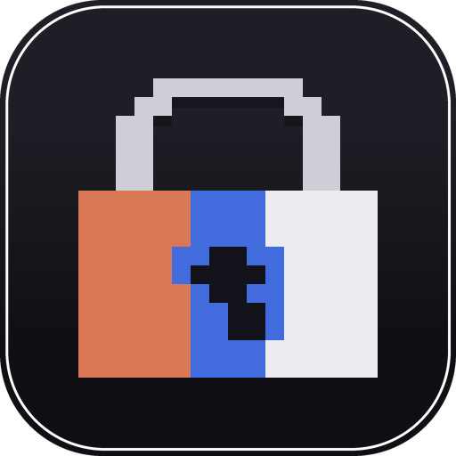
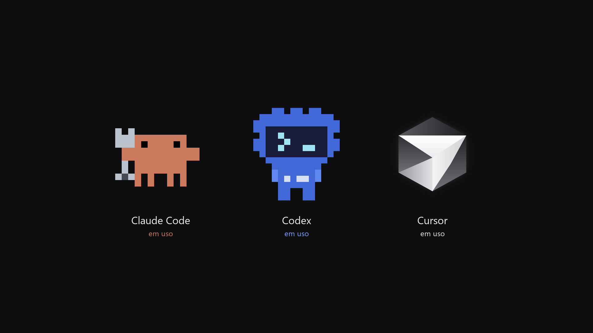
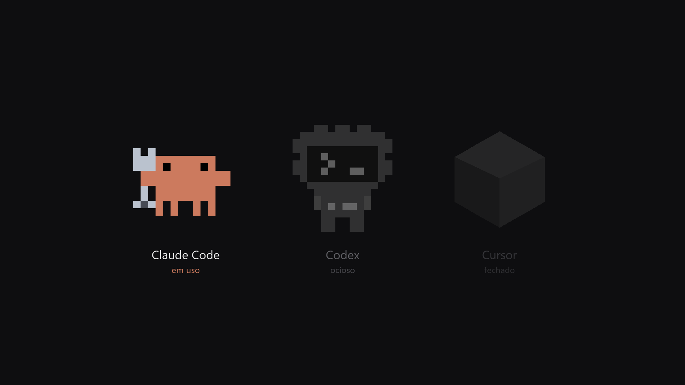
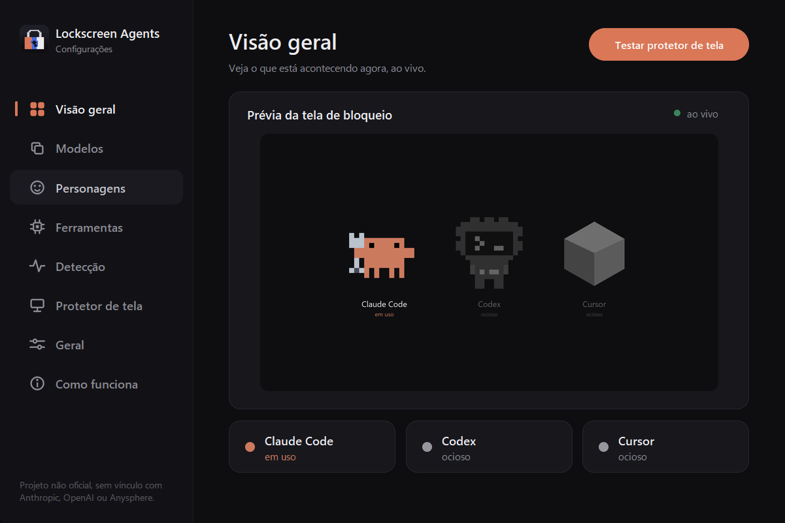
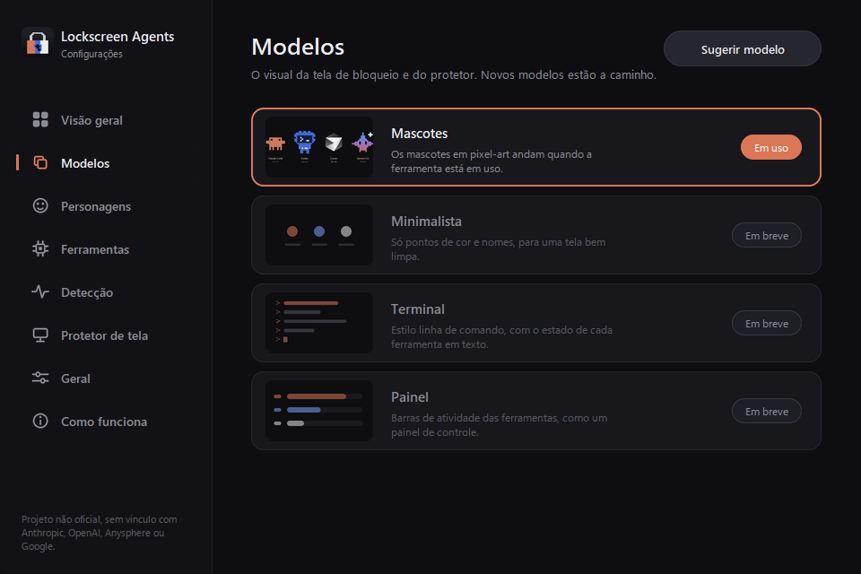
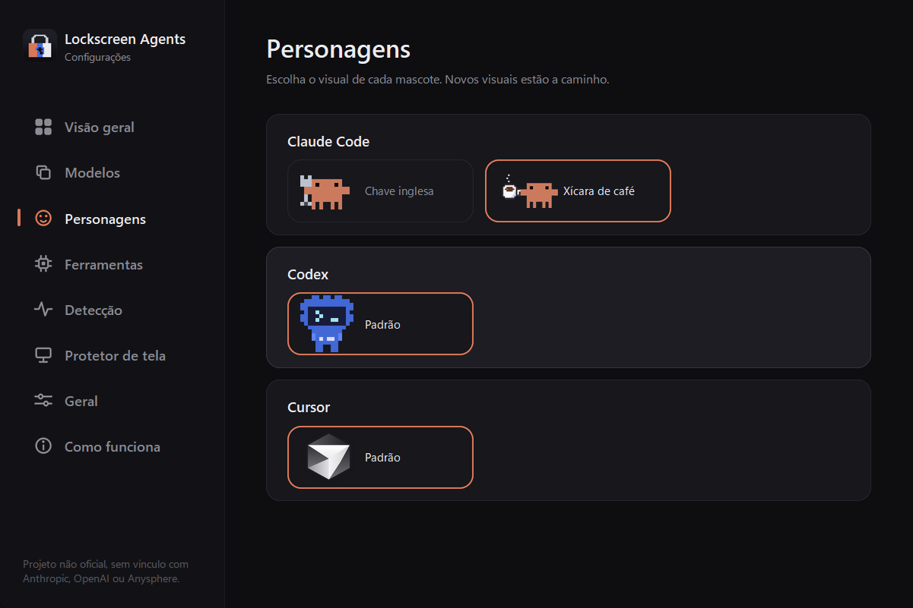
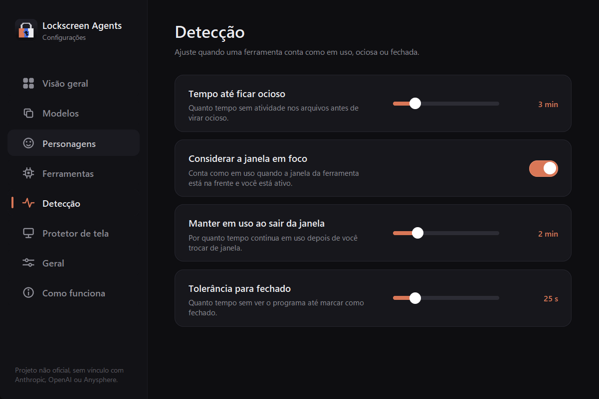

<p align="center"></p>

<h1 align="center">Lockscreen Agents</h1>

**Português** · [English](#english)

Mascotes na tela de bloqueio e no protetor de tela do Windows (e, a partir do código-fonte, do macOS) que mostram, num relance, quais assistentes de código você está usando: **Claude Code**, **Codex**, **Cursor** e **Gemini CLI**.



| Estado | Como aparece |
| --- | --- |
| **em uso** | mascote colorido (no protetor de tela ele anda; o Cursor flutua) |
| **ocioso** | ferramenta aberta, sem atividade: mascote cinza e parado |
| **fechado** | ferramenta não está rodando: mascote bem apagado |



> Projeto **não oficial**. Não tem vínculo com a Anthropic, a OpenAI, a Anysphere (Cursor) nem o Google (Gemini). Os mascotes são desenhos próprios, inspirados nas ferramentas. Claude, Codex, Cursor e Gemini são marcas dos respectivos donos.

## O que faz

- **Tela de bloqueio**: gera uma imagem com o estado de cada ferramenta e a define como lock screen sempre que o estado muda. Aperte `Win + L` e veja. No macOS isso é opcional, veja [macOS](#macos).
- **Protetor de tela animado**: depois de alguns minutos sem mexer no PC, abre uma tela cheia com os mascotes animados. Qualquer tecla ou movimento do mouse fecha. Ele não abre durante vídeos, chamadas e apresentações (dá para desligar isso nas configurações).
- **Janela de configurações** moderna e animada, com prévia ao vivo da tela de bloqueio (veja abaixo).
- **Ícone na bandeja** (perto do relógio; na barra de menus, no macOS): clique duas vezes para abrir as configurações; o menu também pausa, atualiza a lock screen e testa o protetor.
- Inicia junto com o Windows (ou com o login, no macOS).

## Configurações

Clique duas vezes no ícone da bandeja (ou use **Configurações…** no menu). Tudo é salvo na hora.



- **Modelos**: o visual da tela. Hoje existe o modelo **Mascotes**; os próximos aparecem como “em breve” (e há um botão para sugerir o seu).
- **Personagens**: o visual de cada mascote. O Claude Code e o Codex já podem segurar uma **xícara de café** (com vapor), e todos os mascotes podem usar um **chapéu de Natal**; mais visuais estão a caminho.
- **Ferramentas**: escolha quais mascotes aparecem (Claude Code, Codex, Cursor, Gemini CLI).
- **Detecção**: tempo até ficar ocioso, tolerância para "fechado" e se a janela em foco conta como em uso.
- **Protetor de tela**: ligar, abrir após N minutos, não abrir durante vídeos e chamadas, bloquear o PC ao fechar.
- **Geral**: idioma (automático, português ou inglês), iniciar com o Windows, abrir a pasta de dados e restaurar os padrões. No macOS há também "Mostrar na tela de bloqueio".
- **Como funciona**: explica como o app sabe se uma IA está em uso e mostra, ao vivo, os sinais lidos de cada ferramenta.








## Requisitos

- Windows 10 ou 11, ou macOS (só pelo código-fonte, veja [macOS](#macos))
- Python 3.10 ou mais novo, com `tkinter` (já vem no instalador oficial de python.org)
- Windows: a tela de bloqueio precisa estar em **Configurações → Personalização → Tela de bloqueio → Personalizar sua tela de bloqueio: Imagem**. No modo "Windows Spotlight" o Windows ignora a imagem do app.

## Instalação

### Instalador (Windows 10/11)

Baixe o `LockscreenAgents-Setup-<versão>.exe` na página de **Releases** e execute. Não precisa de Python nem de administrador. Também há uma versão portátil em `.zip` (extraia e abra `LockscreenAgents.exe`).

> O instalador ainda **não é assinado digitalmente**, então o Windows pode mostrar o aviso do SmartScreen ("Windows protegeu seu PC"). Clique em **Mais informações → Executar assim mesmo**. Os arquivos da Release são gerados automaticamente a partir deste código pelo GitHub Actions, e o `SHA256SUMS.txt` permite conferir a integridade.

### A partir do código-fonte

```bash
git clone https://github.com/andrrc/lockscreen-agents.git
cd lockscreen-agents
pip install -r requirements.txt
python packaging/windows/install.py
```

O `packaging/windows/install.py` copia o app para `%LOCALAPPDATA%\LockscreenAgents`, liga o início automático (chave `Run` do registro e atalho na pasta Inicializar) e abre o app. Procure o ícone do cadeado perto do relógio. Pode apagar a pasta do projeto depois, o app instalado não depende dela.

Sem usar Git: baixe o ZIP em **Releases** (ou em *Code → Download ZIP*), extraia e rode os dois últimos comandos acima.

Para remover:

```bash
python packaging/windows/install.py --uninstall
```

Isso desliga o início automático e fecha o app. A pasta `%LOCALAPPDATA%\LockscreenAgents` fica; apague se quiser.

### macOS

O port para macOS roda **pelo código-fonte**: ainda não há `.app` nem instalador. Foi feito por um colaborador e a maior parte das leituras do sistema foi testada num Mac, mas alguns pontos ainda não foram conferidos em todos os cenários (veja [docs/MACOS.md](docs/MACOS.md)).

```bash
git clone https://github.com/andrrc/lockscreen-agents.git
cd lockscreen-agents
python3 -m venv .venv && source .venv/bin/activate
pip install -r requirements.txt
python app.py
```

O ícone deve aparecer na barra de menus (a bandeja ainda não foi conferida em todas as versões do macOS). O macOS pede permissão de **Automação** (System Events e Finder) na primeira vez que o app lê a janela em foco ou troca o papel de parede; se você negar, o app continua funcionando, só sem esse sinal. Para iniciar com o login, ligue o início automático em **Configurações → Geral** (cria um LaunchAgent em `~/Library/LaunchAgents`).

O macOS não tem API para trocar só a imagem da tela de bloqueio: ela mostra o papel de parede. Por isso o app só mexe nele se você ligar **Mostrar na tela de bloqueio** em **Configurações → Geral**. Com a opção ligada, o papel de parede é trocado enquanto o Mac está bloqueado e o original volta ao desbloquear, ao pausar, ao sair, em **Restaurar papel de parede original** no menu ou, se o app tiver fechado de repente, na próxima inicialização. Em último caso, rode `python app.py --restore-wallpaper`. Com vários monitores, cada um recebe o seu papel de parede de volta. Se o app não conseguir ler o papel de parede atual, ele não troca nada.

## Como ele sabe que a ferramenta está em uso

Tudo local, sem login e sem internet. O app **não lê o conteúdo** de nada, só olha:

- a **data de modificação** dos arquivos que cada ferramenta grava enquanto responde: `~/.claude/projects/*/*.jsonl`, `~/.codex/sessions/AAAA/MM/DD/*.jsonl`, arquivos de `~/.cursor` e `~/.gemini/tmp/*/chats/*` e `~/.gemini/tmp/*/logs.json`;
- a **lista de processos** (`claude.exe`, `codex.exe`, `cursor.exe`; no macOS, `Claude`, `Codex` e `Cursor`) para saber se está aberta;
- **qual janela está em foco** e se você mexeu no teclado ou mouse nos últimos 3 minutos. O Cursor, por exemplo, quase não grava arquivos enquanto você só edita código.
- O **Gemini CLI** roda dentro do Node (`node.exe`), então não dá para reconhecer o processo dele. No lugar, arquivos dele mexidos nos últimos 30 minutos contam como **ocioso** (aberto); depois disso, **fechado**.

Regras: arquivo mudou nos últimos 3 minutos ou janela da ferramenta em foco (com você ativo, e por mais 2 minutos depois de perder o foco) → **em uso**. Processo aberto, sem atividade → **ocioso**. Sem processo por mais de 25 segundos → **fechado**. Todos esses tempos podem ser ajustados na página **Detecção** das configurações.

## Limitações

- O Windows é a plataforma completa, com instalador. O macOS funciona pelo código-fonte, mas sem `.app`, e com limites: a imagem só aparece na tela de bloqueio trocando o papel de parede (opcional), o protetor cobre só o monitor principal e a opção "bloquear o PC ao fechar o protetor" só apaga a tela (o Mac só pede senha se "Exigir senha" estiver em "imediatamente"). Detalhes em [docs/MACOS.md](docs/MACOS.md).
- A lock screen é uma **imagem estática** atualizada a cada mudança de estado, não uma animação. A animação fica no protetor de tela.
- O protetor é aberto pelo próprio app quando o PC fica parado (não é um arquivo `.scr`).
- Idiomas disponíveis: português e inglês. Para adicionar outro, edite `i18n.py`.
- Se o app não aparecer na bandeja depois de reiniciar o PC, abra `%LOCALAPPDATA%\LockscreenAgents\log.txt` e rode `python packaging/windows/install.py` de novo.

## Estrutura

```
app.py                  entrada: python app.py [--settings | --saver /s]
lockscreen_agents/      o app (bandeja, janela de configurações, protetor, detector, desenho)
  platforms/            tudo que depende do sistema operacional (Windows pronto, macOS funcional pelo código-fonte)
packaging/windows/      executável (PyInstaller), instalador (Inno Setup) e instalação pelo código-fonte
tools/                  gera as imagens da pasta docs/
tests/                  testes (pytest)
docs/                   arquitetura, guia do macOS e imagens
```

Detalhes em [docs/ARCHITECTURE.md](docs/ARCHITECTURE.md).

## Gerando o executável

```bash
pip install -r requirements.txt pyinstaller
python packaging/windows/build_exe.py
```

Gera `build/dist/LockscreenAgents/LockscreenAgents.exe`. Para o instalador, instale o [Inno Setup 6](https://jrsoftware.org/isinfo.php) e rode `ISCC.exe /DMyAppVersion=0.1.0 packaging\windows\installer.iss`. Ao enviar uma tag `vX.Y.Z` (igual ao `lockscreen_agents/version.py`), o workflow `.github/workflows/release.yml` faz tudo isso e publica a Release.

## Contribuindo

Issues e PRs são bem-vindos: novos mascotes ou ferramentas, traduções, melhorias na detecção.
Veja o [guia de contribuição](CONTRIBUTING.md) para rodar o projeto, os testes e o fluxo de pull request.

**macOS:** o port já funciona; o que falta (empacotamento em `.app`, bloqueio real da tela, vários monitores no protetor) está em [docs/MACOS.md](docs/MACOS.md). Testes em um Mac de verdade são muito bem-vindos.

## Licença

[MIT](LICENSE)

---

## English

Mascots on the Windows (and, from source, macOS) lock screen and screensaver that show at a glance which AI coding assistants you are using: **Claude Code**, **Codex**, **Cursor** and **Gemini CLI**.

- **in use** (labelled “em uso”): colored mascot (walking in the screensaver, Cursor floats)
- **idle** (“ocioso”): tool is open but quiet, gray and still
- **closed** (“fechado”): tool is not running, very dim

> **Unofficial** project, not affiliated with Anthropic, OpenAI, Anysphere (Cursor) or Google (Gemini). The mascots are original drawings inspired by the tools. Claude, Codex, Cursor and Gemini are trademarks of their respective owners.


### Features

- **Lock screen**: renders an image with each tool's state and sets it as your lock screen whenever the state changes. Press `Win + L` to see it. On macOS this is optional, see [macOS](#macos-1).
- **Animated screensaver**: after a few idle minutes, a fullscreen scene with the animated mascots. Any key or mouse move closes it. It does not open during videos, calls or presentations (you can turn that off in the settings).
- **Settings window**: modern and animated, with a live lock screen preview. Browse the templates (more are coming soon), pick each mascot's look (Claude Code and Codex can hold a coffee cup, and all three can wear a Christmas hat), see live how detection works, pick which tools show up, tune the detection timings, configure the screensaver and switch language (Portuguese/English). Everything saves instantly.
- **Tray icon** (menu bar on macOS): double-click to open the settings; the menu also pauses, refreshes the lock screen and tests the screensaver.
- Starts with Windows (or at login on macOS).

### Requirements

- Windows 10 or 11, or macOS (from source only, see [macOS](#macos-1))
- Python 3.10+ with `tkinter` (included in the python.org installer)
- Windows: lock screen set to **Picture** (Settings → Personalization → Lock screen). Windows ignores the image in “Windows Spotlight” mode.

### Install

**Installer (Windows 10/11):** download `LockscreenAgents-Setup-<version>.exe` from **Releases** and run it. No Python or admin rights needed. A portable `.zip` is also available. The installer is not code-signed yet, so Windows SmartScreen may warn you: click **More info → Run anyway**. Release files are built automatically from this repository by GitHub Actions; `SHA256SUMS.txt` lets you verify them.

**From source:**

```bash
git clone https://github.com/andrrc/lockscreen-agents.git
cd lockscreen-agents
pip install -r requirements.txt
python packaging/windows/install.py
```

`install.py` copies the app to `%LOCALAPPDATA%\LockscreenAgents`, enables autostart (registry `Run` key plus a Startup-folder shortcut) and launches it. Look for the padlock icon near the clock. No Git? Download the ZIP from **Releases**, extract it and run the last two commands.

Uninstall with `python packaging/windows/install.py --uninstall`.

### macOS

The macOS port runs **from source**: there is no `.app` or installer yet. A contributor built it and most system reads were tested on a real Mac, but some points are still unchecked in some scenarios (see [docs/MACOS.md](docs/MACOS.md)).

```bash
git clone https://github.com/andrrc/lockscreen-agents.git
cd lockscreen-agents
python3 -m venv .venv && source .venv/bin/activate
pip install -r requirements.txt
python app.py
```

The icon should show up in the menu bar (the tray has not been checked on every macOS version). macOS asks for **Automation** permission (System Events and Finder) the first time the app reads the focused window or changes the wallpaper; if you deny it, the app keeps working, just without that signal. To start at login, turn on autostart in **Settings → General** (it creates a LaunchAgent in `~/Library/LaunchAgents`).

macOS has no API to change only the lock screen image: it shows the desktop wallpaper. So the app only touches it if you turn on **Show on the lock screen** in **Settings → General**. With it on, the wallpaper is replaced while the Mac is locked and the original comes back when you unlock, pause, quit, use **Restore original wallpaper** in the menu or, if the app closed abruptly, on the next start. As a last resort, run `python app.py --restore-wallpaper`. With several displays, each gets its own wallpaper back. If the app cannot read the current wallpaper, it changes nothing.

### How it detects usage

Fully local, no login, no network. It never reads file contents, only:

- **modification times** of files each tool writes while it is answering (`~/.claude/projects`, `~/.codex/sessions`, `~/.cursor`, `~/.gemini/tmp`);
- the **process list** (`claude.exe`, `codex.exe`, `cursor.exe`; `Claude`, `Codex` and `Cursor` on macOS);
- the **foreground window**, plus whether you used the keyboard or mouse in the last 3 minutes.
- **Gemini CLI** runs inside Node (`node.exe`), so its process can't be told apart. Instead, its files changing in the last 30 minutes count as **idle** (open); after that, **closed**.

Recent file activity or the tool in focus while you are active → **in use**. Process running, no activity → **idle**. No process for 25+ seconds → **closed**. All thresholds are adjustable on the **Detection** page of the settings window.

### Limitations

- Windows is the complete platform, with an installer. macOS works from source, without an `.app`, and with limits: the image only reaches the lock screen by swapping the wallpaper (optional), the screensaver covers only the main display, and the "lock the PC when the screensaver closes" option only turns the display off (the Mac asks for a password only if "Require password" is set to "immediately"). Details in [docs/MACOS.md](docs/MACOS.md).
- The lock screen is a **static image** refreshed on state changes; the animation lives in the screensaver, which the tray app launches when the PC is idle (it is not a `.scr` file).
- Available languages: Portuguese and English. To add another one, edit `i18n.py`.

### License

[MIT](LICENSE)
